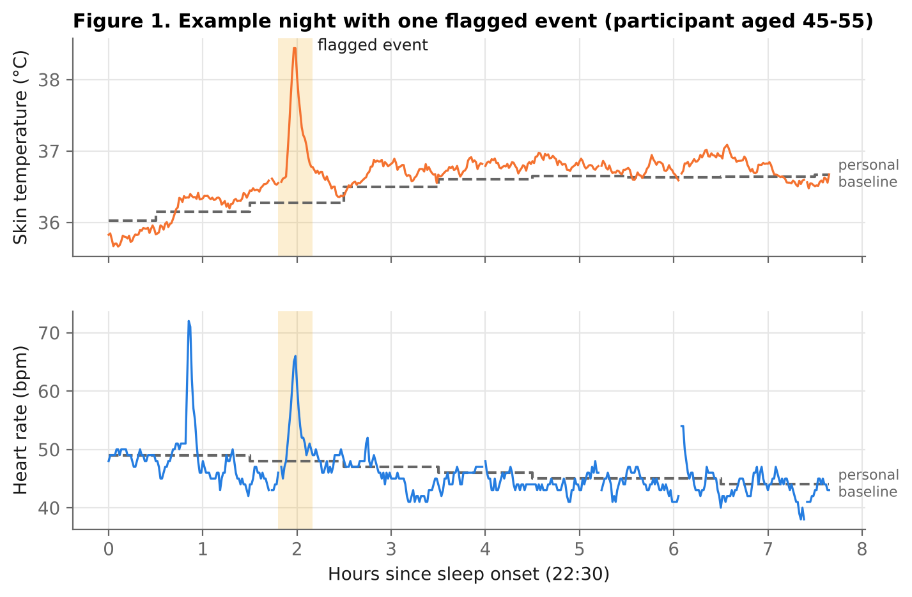

# Nocturnal thermoregulatory events in wearable data

A SQL-first pipeline that finds sudden skin-temperature and heart-rate rises during sleep, measured against each person's own baseline, and compares how often they happen in women aged 45 to 55 (menopause-transition age) and women aged 18 to 34.

PostgreSQL does the cleaning, baselines and event detection. Python fits the final model and makes the figures.

**Write-up with results:** [REPORT.md](REPORT.md)

> **Synthetic data.** The real ring data can't be shared, so everything in this repo, including the numbers in the report, comes from a simulated dataset built to have the same structure (`python/00_generate_synthetic.py`). The pipeline doesn't know the data is synthetic. Point it at a real database with the same three tables and it runs unchanged.



## Quick start

### With Docker

```bash
docker compose up --build
```

This starts Postgres 16, generates the full synthetic dataset, runs every step and writes `results/` and `figures/`. It takes about 10 minutes on a laptop, and the leave-one-out refits are most of that.

### Without Docker

Needs PostgreSQL 14+ (with `psql` on your PATH) and Python 3.10+.

```bash
createdb thermo
pip install -r requirements.txt
export DATABASE_URL=postgresql://postgres@localhost:5432/thermo
./run_all.sh --demo      # ~40 participants, under a minute
./run_all.sh             # full ~600 participants
```

## Pipeline

| Step | File | What it does |
|---|---|---|
| 0 | `sql/00_schema.sql` | `participants`, `sleep_periods`, `raw_readings` (+ `sim_truth` for the synthetic data only) |
| – | `python/00_generate_synthetic.py` | builds and loads the synthetic dataset |
| 1 | `sql/01_clean.sql` | drops impossible values (temp outside 20–42 °C, HR outside 30–200 bpm) and ring-off stretches, marks gaps with `LAG`, keeps nights with ≥ 5 h of valid data |
| 2 | `sql/02_baseline.sql` | per-person, per-hour-of-night median and MAD with `percentile_cont` |
| 3 | `sql/03_score.sql` | robust z-scores against that baseline, then a trailing 10-minute window (mean temp z, max HR rise) |
| 4 | `sql/04_detect.sql` | `detect_events(temp_thr, hr_thr, merge_gap)`: flag minutes with temp z > 2.0 and HR ≥ 8 bpm over baseline, merge flags within 15 min (gaps-and-islands) |
| 5 | `sql/05_person_nights.sql` | `person_nights(...)`: one row per night with event count, hours slept, bedtime, season, age group |
| 6 | `python/02_compare_groups.py` | negative binomial mixed model (random intercept per participant, log hours as offset), bootstrap CIs, GEE cross-check |
| 7 | `python/03_robustness.py` | ±20% threshold grid and leave-one-participant-out refits |
| 8 | `python/04_check_against_truth.py` | matches detections to what was injected into the synthetic data |
| 9 | `python/05_figures.py` | figures 1–4 |

`python/01_run_sql.py` runs steps 1–5 in order. Steps 4 and 5 are SQL functions, so the robustness script can re-run detection at other thresholds without copying the query:

```sql
SELECT age_group, AVG(n_events) FROM person_nights(1.6, 6.4) GROUP BY 1;
```

### The two queries that do most of the work

Baseline by participant and hour of night (`sql/02_baseline.sql`):

```sql
CREATE TABLE baselines AS
WITH hourly AS (
  SELECT participant_id,
         EXTRACT(HOUR FROM ts) AS hour_of_night,
         skin_temp, heart_rate
  FROM clean_readings
),
med AS (
  SELECT participant_id, hour_of_night,
         percentile_cont(0.5) WITHIN GROUP (ORDER BY skin_temp)  AS temp_med,
         percentile_cont(0.5) WITHIN GROUP (ORDER BY heart_rate) AS hr_med
  FROM hourly
  GROUP BY participant_id, hour_of_night
)
SELECT h.participant_id, h.hour_of_night, m.temp_med, m.hr_med,
       percentile_cont(0.5) WITHIN GROUP (ORDER BY ABS(h.skin_temp  - m.temp_med)) AS temp_mad,
       percentile_cont(0.5) WITHIN GROUP (ORDER BY ABS(h.heart_rate - m.hr_med))   AS hr_mad
FROM hourly h
JOIN med m USING (participant_id, hour_of_night)
GROUP BY h.participant_id, h.hour_of_night, m.temp_med, m.hr_med;
```

Merging flagged minutes into events (`sql/04_detect.sql`, simplified):

```sql
WITH flagged AS (
  SELECT participant_id, sleep_period_id, ts
  FROM scored_readings
  WHERE temp_z > 2.0 AND hr_delta >= 8
),
marked AS (
  SELECT *,
         CASE WHEN LAG(ts) OVER w IS NULL
                OR ts - LAG(ts) OVER w > INTERVAL '15 minutes'
              THEN 1 ELSE 0 END AS new_event
  FROM flagged
  WINDOW w AS (PARTITION BY sleep_period_id ORDER BY ts)
),
numbered AS (
  SELECT *, SUM(new_event) OVER (PARTITION BY sleep_period_id ORDER BY ts) AS event_id
  FROM marked
)
SELECT participant_id, sleep_period_id, event_id, MIN(ts) AS start_ts, MAX(ts) AS end_ts
FROM numbered
GROUP BY participant_id, sleep_period_id, event_id;
```

## Using your own data

Load three tables matching `sql/00_schema.sql`:

- `participants(participant_id, age_group)` with `age_group` of `'18-34'` or `'45-55'`
- `sleep_periods(sleep_period_id, participant_id, sleep_start, sleep_end)`
- `raw_readings(participant_id, ts, skin_temp, heart_rate)` at one-minute resolution

Then run `python python/01_run_sql.py` onwards. Skip `04_check_against_truth.py`, since real data has no truth table. Do the visual review instead.

## Demo data

`data/demo/` holds a small synthetic dataset (40 participants, ~2,000 nights, gzipped CSVs) for poking at without running anything. To rebuild it, run the command below. The generator also reloads whatever database `DATABASE_URL` points at, so point it at a scratch one:

```bash
DATABASE_URL=postgresql://postgres@localhost:5432/scratch \
  python python/00_generate_synthetic.py --demo --csv-out data/demo
```

## Layout

```
sql/        numbered SQL steps
python/     data generation, model, robustness, figures
results/    summary.json, model output, robustness tables
figures/    PNGs used in the report
data/demo/  small synthetic CSVs
```
