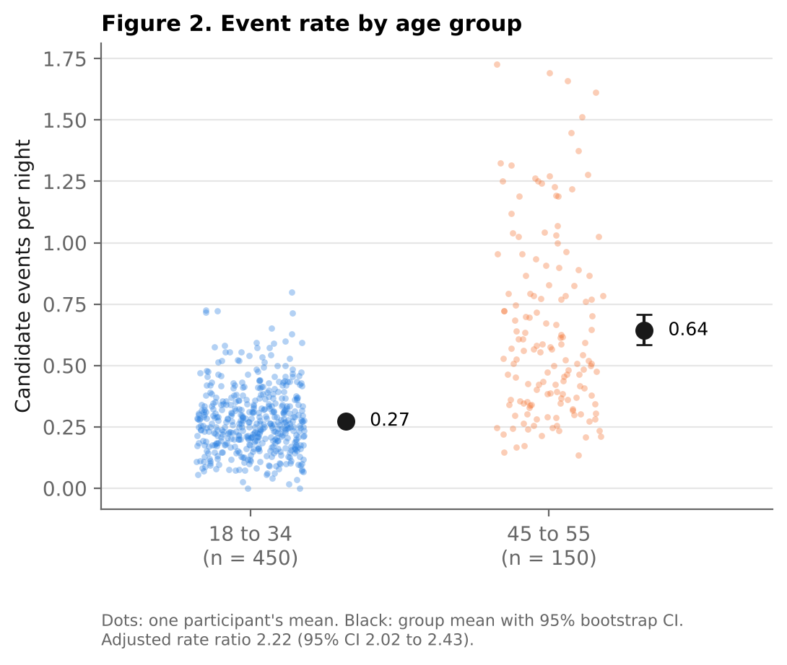
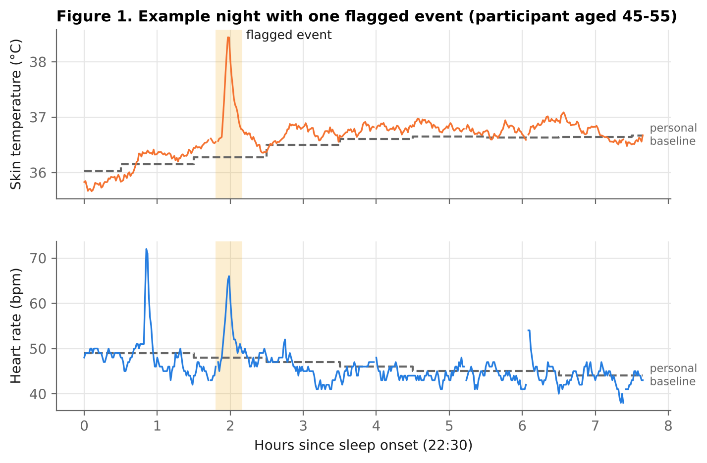
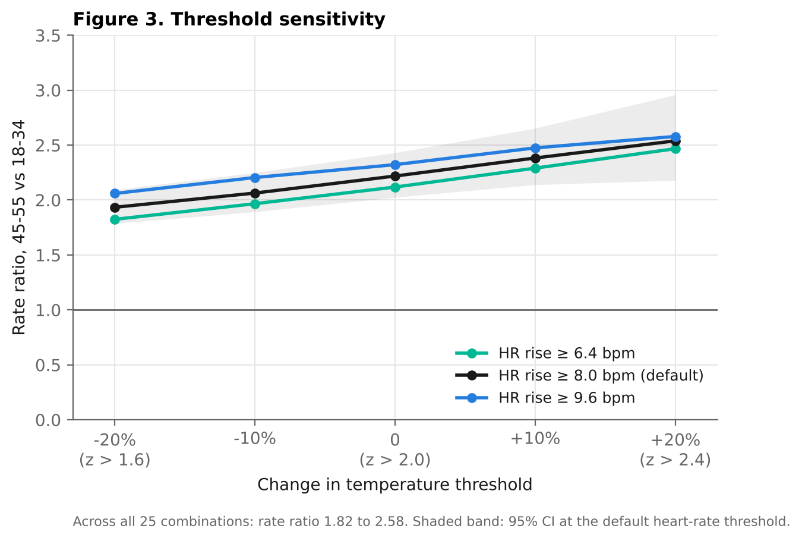
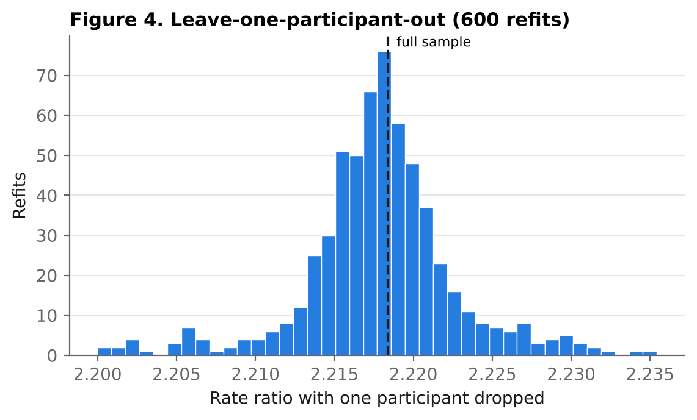

# Detecting Nocturnal Thermoregulatory Events in Wearable Data

Nov 2026 · @Nish

## Summary

I built a SQL-first pipeline, with PostgreSQL doing the cleaning, baselines and event detection and Python fitting the final model, to detect sudden skin-temperature and heart-rate rises during sleep, measured against each person's own baseline. I then compared how often these events occur in women of menopause-transition age (45 to 55) and in women aged 18 to 34.

Across 600 participants and 26,192 valid nights, the detector flagged 10,350 candidate events. Women aged 45 to 55 had 0.64 events per night versus 0.27 in the younger group (adjusted rate ratio 2.22, 95% CI 2.02 to 2.43). The difference held across a ±20% grid of detection thresholds (rate ratio 1.82 to 2.58) and when each participant was dropped in turn (2.20 to 2.24).

> **These results come from synthetic data.** The real ring data can't be shared, so the pipeline was run on a simulated dataset with the same structure (`python/00_generate_synthetic.py`). The simulation knows which surges are real, so I could also measure how well the detector recovers them, which wouldn't be possible with unlabeled real data. The events are *candidate* thermoregulatory events, not confirmed hot flashes.

## Background and question

Hot flashes and night sweats are mostly studied through self-report, which is subjective and misses events that happen during sleep. Wearable rings and bands record skin temperature and heart rate continuously, which makes it possible to look for the physical signature of these episodes: a quick rise in skin temperature with a rise in heart rate.

Skin temperature differs a lot from person to person and follows a strong daily rhythm, so a fixed cutoff does not work. I measured every rise against that person's own normal for that hour of the night.

**The question:** can nocturnal temperature-and-heart-rate surges be detected reliably in wearable data, and do they occur more often or look different in women of menopause-transition age than in younger women?

## Data

The dataset is a synthetic stand-in for de-identified ring data. It has per-minute skin temperature and heart rate, sleep timing and an age group per participant. It's generated with a fixed seed, so every number here can be reproduced with `./run_all.sh`.

What the simulation includes:

- Person-level baselines, a within-night temperature climb and heart-rate drift, and autocorrelated noise.
- A luteal-phase temperature and heart-rate shift in the 18 to 34 group.
- Injected thermoregulatory surges: a fast skin-temperature rise (1.0 to 2.2 °C) with a heart-rate rise (10 to 22 bpm), decaying over roughly 10 to 25 minutes. They're more frequent in the 45 to 55 group, and the rate varies between people.
- Lookalikes that aren't hot flashes: warm arousals (smaller temperature and HR bumps), alcohol nights (HR and temperature raised all night), and temperature-only and HR-only bumps.
- The usual data problems: dropped minutes, longer gaps, short nights, ring-off periods and impossible sensor values.

| | |
|---|---|
| Participants | 600 (150 aged 45 to 55, 450 aged 18 to 34) |
| Recorded nights | 27,929 |
| Valid nights (≥ 5 h of clean data) | 26,192 (93.8%) |
| Minute readings, raw → clean | 11.70 M → 11.22 M (95.9% kept) |
| Mean valid sleep per night | 7.1 h (same in both groups) |
| Self-reports | none |

Storage: a PostgreSQL database with three tables, `participants` (id, age group), `sleep_periods` (id, start, end) and `raw_readings` (timestamp, skin temperature, heart rate).

## Methods

1. **Cleaning in SQL** (`sql/01_clean.sql`). I loaded the raw readings, kept only readings inside a sleep period, and filtered out physiologically impossible values: skin temperature outside 20 to 42 °C or heart rate outside 30 to 200 bpm. Ring-off stretches read as cold but technically in range, so I also dropped readings more than 4 °C below that night's median. I marked gaps with a `LAG` window function over timestamps and kept only nights with at least 5 hours of valid minutes.
2. **Personal baseline in SQL** (`sql/02_baseline.sql`). For each person and clock hour of the night I computed the median and median absolute deviation with `percentile_cont`, stored them in a `baselines` table and joined them back to the readings to get robust z-scores, (value − median) / (1.4826 × MAD). The median-based baseline keeps the events I was looking for from distorting it.
3. **Event rule in SQL** (`sql/03_score.sql`, `sql/04_detect.sql`). Over a trailing 10-minute window, a minute was flagged when the mean temperature z-score was above 2.0 and heart rate peaked at least 8 bpm above baseline, with at least 6 of the 10 minutes present. A gaps-and-islands query (`LAG` plus a running `SUM`) merged flags within 15 minutes of each other into one event. Detection is a SQL function, `detect_events(temp_thr, hr_thr, merge_gap)`, so the robustness checks re-run the same query at other thresholds.
4. **Check against ground truth** (`python/04_check_against_truth.py`). This replaces the visual review I'd do with real data. Each detected event was matched to whatever injected signal it overlapped. Events matching a real surge count as plausible, warm arousals and alcohol nights as confounders, single-signal bumps as artifacts, and anything else as noise.
5. **Group comparison** (`sql/05_person_nights.sql`, `python/02_compare_groups.py`). A final SQL query produced one row per person-night: event count, hours slept, bedtime, season and age group. On that table I fitted a negative binomial mixed model with log hours of sleep as an offset, bedtime and season as covariates, and a random intercept per participant, since nights from one person are not independent. The model is fitted by maximum likelihood with Gauss-Hermite quadrature (`python/nbglmm.py`). As a cross-check I also fitted a population-averaged NB GEE with exchangeable correlation. Group means come with participant-level bootstrap CIs (2,000 resamples).

## Results

The detector flagged **10,350** candidate events across 26,192 nights.

| Age group | Participants | Nights | Events | Events per night (95% CI) | Nights with ≥ 1 event |
|---|---|---|---|---|---|
| 45 to 55 | 150 | 8,611 | 5,533 | **0.64** (0.58 to 0.71) | 43.7% |
| 18 to 34 | 450 | 17,581 | 4,817 | **0.27** (0.26 to 0.29) | 21.3% |

After adjusting for sleep length, bedtime and season, the rate ratio was **2.22 (95% CI 2.02 to 2.43)**. The crude ratio was 2.35 and the GEE gave 2.35 (2.12 to 2.59). Bedtime and season had no detectable effect, which is right, since none was simulated. Between-person variation was substantial (random-intercept SD 0.42 on the log scale).

**What the events look like.** The median flagged event lasted 12 minutes (IQR 8 to 15), with a peak temperature rise of 4.9 robust z-scores and a peak heart-rate rise of 12 bpm. Events in the older group were larger: median peak z 6.1 versus 3.7, and HR rise 13 versus 11 bpm. More of the younger group's events are smaller lookalikes (see below).

*Figure 1. The surge just before 2 h is flagged. The heart-rate spike at 0.9 h isn't, because skin temperature didn't move.*

### How good is the detector?

Because the data is simulated, I can check every detection against what was actually injected.

| Detected events matching… | All | 45 to 55 | 18 to 34 |
|---|---|---|---|
| a real thermoregulatory surge (plausible) | 64.5% | 75.8% | 51.5% |
| a warm arousal or alcohol night (confounder) | 29.5% | 20.6% | 39.6% |
| a temperature-only or HR-only bump (artifact) | 5.6% | 3.6% | 7.8% |
| nothing injected (noise) | 0.5% | 0.1% | 1.0% |

- **Recall is high:** 95.2% of injected surges on valid nights were detected (96.6% in the older group, 92.7% in the younger).
- **Precision is the weak point**, and it's worse in the younger group. Confounders happen at about the same rate in both groups, so they make up a bigger share where real surges are rare.
- **This biases the comparison toward 1.** The true injected rate ratio is **3.42** (0.53 vs 0.16 surges per night). Counting only plausible detections gives 3.45, so the detector itself is fine on real surges. The headline 2.22 is lower because about 0.1 to 0.15 confounder events per night are added to both groups. The real difference is larger than the one the detector reports.

## Robustness checks

**Threshold sensitivity** (`python/03_robustness.py`). I varied the temperature threshold (z 1.6 to 2.4) and the heart-rate threshold (6.4 to 9.6 bpm) each by −20%, −10%, 0, +10% and +20%, re-ran detection in SQL and refitted the model for all 25 combinations. The rate ratio stayed between **1.82 and 2.58**, and the event count ranged from 7,811 to 13,342. The temperature threshold matters most: stricter thresholds push the ratio up (1.93 at z > 1.6, 2.54 at z > 2.4, with the default HR threshold), consistent with filtering out more of the low-amplitude confounders. The 7.2 and 8.0 bpm columns give identical results, because heart rate is recorded in whole beats and most hourly medians are whole numbers, so "≥ 7.2" and "≥ 8" select the same minutes.

**Leave-one-participant-out.** I refitted the model 600 times, dropping one participant each time. The rate ratio ranged from **2.20 to 2.24**, so no single participant drives the result.

**Labels.** There are no self-reports, so I didn't train a classifier. The ground-truth check above is only possible because the data is simulated.

## Limitations

- **Synthetic data.** The numbers here show the pipeline works and how the detector behaves when its assumptions roughly hold. They say nothing about real women. The simulated event rates and effect sizes are my assumptions, not findings.
- **Candidate events only.** On real data, without self-reports, these can't be called hot flashes. They match the expected physical signature and nothing more.
- **Confounders are the main error source.** In the simulation, warm arousals and alcohol nights made up 30% of detections and pulled the rate ratio down from about 3.4 to 2.2. Real data probably has more kinds of lookalikes, such as illness, medications, sleep apnea, room temperature and bedding.
- **Age is a proxy.** Menopause stage depends on menstrual-cycle history, not age alone.
- **Menstrual cycle.** The luteal-phase temperature shift in younger women widens their baseline spread, which can create or hide events. The hourly baseline pools both phases.
- **Sample.** Ring owners are not representative, and 150 participants in the older group limits how much can be claimed.

## Next steps

- Validate against self-reported hot flashes or night sweats.
- Account for menstrual-cycle phase, for example with a baseline split by phase.
- Add features that separate confounders: alcohol nights raise HR all night, while hot flashes are short spikes.
- Test whether the same detector transfers to a second device or dataset.

## Code

Everything is in this repo, with SQL and Python in numbered order: clean, baseline, score, detect, compare, robustness, figures. `./run_all.sh` (or `docker compose up --build`) reproduces every number and figure above. A small synthetic demo dataset is in `data/demo/`. Full model output is in `results/model_summary.txt`, and all summary numbers are in `results/summary.json` and `results/truth_check.json`.
